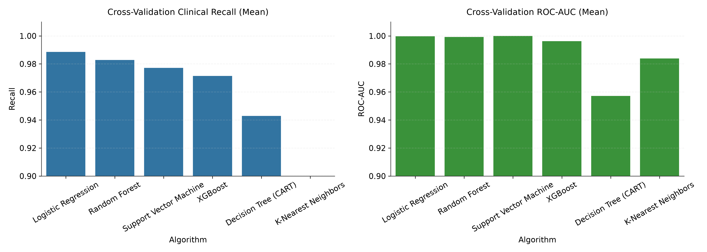

# CHƯƠNG 3: HUẤN LUYỆN, TINH CHỈNH VÀ ĐÓNG GÓI MÔ HÌNH

**Người thực hiện: Tô Hồng Vũ — Nhóm 01**

Chương này trình bày quy trình thiết lập thực nghiệm học máy có giám sát cho bài toán chẩn đoán bệnh thận mạn tính (CKD), bao gồm: xây dựng phương thức kiểm chứng chéo phân tầng 5-Fold (5-Fold Stratified Cross-Validation) tích hợp trực tiếp bộ tiền xử lý `make_preprocessor()` nhằm ngăn chặn rò rỉ dữ liệu, huấn luyện và đánh giá sơ bộ 6 thuật toán cơ sở (Baseline Models), tinh chỉnh siêu tham số bằng `GridSearchCV` với hàm mục tiêu ưu tiên độ nhạy lâm sàng (`scoring='recall'`), và đóng gói toàn bộ quy trình thành file nhị phân `models/best_model.joblib` kèm bộ kiểm thử tự động (Smoke Test) để bàn giao cho Chương 4 và Chương 5.

---

## 3.1. Thiết lập môi trường thực nghiệm và Phương pháp kiểm chứng chéo

### 3.1.1. Đầu vào thực nghiệm và Hợp đồng dữ liệu (Feature Ordering Contract)

Đầu vào của Chương 3 được tiếp nhận từ bộ bàn giao chuẩn hóa của Chương 2 (`data/processed/`) theo tỷ lệ phân chia 70/30 (`test_size=0.30, stratify=y, random_state=42`):
- **Tập huấn luyện cú pháp sạch chưa điền khuyết (`X_train_raw.csv`, `y_train.csv`):** Gồm $N_{\text{train}} = 280$ bệnh nhân (175 ca `ckd = 1` chiếm 62,5%; 105 ca `notckd = 0` chiếm 37,5%), giữ nguyên 24 thuộc tính đầu vào theo đúng thứ tự trong `feature_contract.json`:
  `age, bp, sg, al, su, rbc, pc, pcc, ba, bgr, bu, sc, sod, pot, hemo, pcv, wc, rc, htn, dm, cad, appet, pe, ane`.
- **Tập kiểm thử độc lập (`X_test_raw.csv`, `y_test.csv`):** Gồm $N_{\text{test}} = 120$ bệnh nhân (75 ca `ckd = 1` chiếm 62,5%; 45 ca `notckd = 0` chiếm 37,5%), được cô lập hoàn toàn trong suốt quá trình đánh giá Baseline và tìm kiếm siêu tham số.

### 3.1.2. Cơ chế chống rò rỉ dữ liệu trong 5-Fold Stratified Cross-Validation

Thay vì sử dụng ma trận `X_train.csv` (đã được fit `SimpleImputer` và `StandardScaler` trên toàn bộ 280 mẫu trước khi chia fold), nhóm sử dụng `X_train_raw.csv` và đóng gói hàm `ckd_preprocessing.make_preprocessor()` vào bên trong đối tượng `sklearn.pipeline.Pipeline` cùng với bộ phân lớp:

```python
pipeline = Pipeline([
    ('preprocessor', ckd_preprocessing.make_preprocessor()),
    ('classifier', clf)
])
cv = StratifiedKFold(n_splits=5, shuffle=True, random_state=42)
```

Với kiến trúc này, tại mỗi vòng lặp thứ $k \in \{1, 2, 3, 4, 5\}$ của `StratifiedKFold`:
1. Tập huấn luyện nội bộ của fold ($4/5 \times 280 = 224$ mẫu, gồm đúng 140 ca CKD và 84 ca Not CKD) được dùng để học `median` (cho 11 biến số), `mode` (cho 13 biến phân loại) và tham số chuẩn hóa Z-score ($\mu, \sigma$), sau đó biến đổi thành ma trận $224 \times 38$ để huấn luyện bộ phân lớp.
2. Tập thẩm định của fold ($1/5 \times 280 = 56$ mẫu, gồm đúng 35 ca CKD và 21 ca Not CKD — chia hết tuyệt đối cho 5) chỉ gọi phương thức `.transform()` dựa trên thống kê đã học từ 224 mẫu huấn luyện của chính fold đó.
3. Hạt giống ngẫu nhiên được cố định tại `SEED = 42` xuyên suốt bộ chia fold và các thuật toán có yếu tố ngẫu nhiên để đảm bảo khả năng tái lập 100%.

---

## 3.2. Huấn luyện thực nghiệm và Đánh giá sơ bộ 6 mô hình Baseline

### 3.2.1. Cấu hình 6 thuật toán cơ sở (Baseline Classifiers)

Nhóm lựa chọn 6 thuật toán đại diện cho 4 trường phái học máy có giám sát đã trình bày tại Chương 1:
1. **Logistic Regression (`penalty='l2', C=1.0, max_iter=1000, random_state=42`):** Mô hình tuyến tính chuẩn với điều chuẩn Ridge ($L_2$) tối ưu hóa hàm mất mát Binary Cross-Entropy.
2. **K-Nearest Neighbors (`n_neighbors=5, metric='minkowski', p=2`):** Thuật toán dựa trên khoảng cách Euclidean với $k=5$ láng giềng gần nhất.
3. **Support Vector Machine (`kernel='rbf', C=1.0, probability=True, random_state=42`):** Máy học vector hỗ trợ cực đại hóa lề mềm với hàm nhân bán kính (RBF Kernel).
4. **Decision Tree — CART (`criterion='gini', random_state=42`):** Cây quyết định đơn lẻ phân chia nút theo độ giảm tạp chất Gini.
5. **Random Forest (`n_estimators=100, criterion='gini', random_state=42`):** Mô hình tổ hợp song song (Bagging) gồm 100 cây quyết định độc lập.
6. **XGBoost (`n_estimators=100, learning_rate=0.1, max_depth=3, eval_metric='logloss', random_state=42`):** Mô hình tổ hợp tuần tự tăng cường độ dốc (Gradient Boosted Decision Trees) có điều chuẩn $L_1/L_2$.

### 3.2.2. Kết quả đối sánh 6 mô hình Baseline qua 5-Fold Stratified CV

Kết quả trung bình (Mean) và độ lệch chuẩn (Std) qua 5 folds trên tập Train ($n = 280$) được trích xuất từ `reports/baseline_cv_metrics.csv` và minh họa tại Hình `reports/figures/baseline_comparison.png`:



| Hạng | Thuật toán Baseline | Accuracy (Mean ± Std) | Precision (Mean) | Recall / Sensitivity (Mean) | F1-Score (Mean) | ROC-AUC (Mean) | Thời gian chạy 5 Folds (s) |
|---:|---|---:|---:|---:|---:|---:|---:|
| **1** | **Logistic Regression (L2)** | 0,9893 ± 0,0087 | 0,9944 | **0,9886** | 0,9914 | 0,9997 | 1,36s |
| **2** | **Random Forest (100 trees)** | 0,9786 ± 0,0208 | 0,9828 | **0,9829** | 0,9828 | 0,9992 | 3,27s |
| **3** | **Support Vector Machine (RBF)** | 0,9857 ± 0,0175 | 1,0000 | **0,9771** | 0,9882 | 1,0000 | 1,35s |
| **4** | **XGBoost (Boosting)** | 0,9679 ± 0,0134 | 0,9776 | **0,9714** | 0,9742 | 0,9962 | 1,46s |
| **5** | **Decision Tree (CART)** | 0,9536 ± 0,0290 | 0,9821 | **0,9429** | 0,9617 | 0,9571 | 1,28s |
| **6** | **K-Nearest Neighbors (k=5)** | 0,9357 ± 0,0143 | 1,0000 | **0,8971** | 0,9456 | 0,9839 | 1,54s |

**Nhận xét sơ bộ từ thực nghiệm Baseline (trên tập Train 280 mẫu):**
- Bốn kiến trúc dẫn đầu (**Logistic Regression**, **Random Forest**, **Support Vector Machine**, **XGBoost**) đều đạt độ nhạy trung bình $\text{Recall} \ge 0,9714$ và $\text{ROC-AUC} \ge 0,9962$.
- **Decision Tree đơn lẻ** ($\text{Recall} = 0,9429$, $\text{ROC-AUC} = 0,9571$, $\text{Std Accuracy} = 0,0290$) có phương sai cao nhất và dễ bị khớp quá mức (overfitting) vào các ngưỡng cắt cục bộ của từng fold; bản thân cấu trúc CART đơn lẻ đã được đại diện và nâng cấp hoàn toàn trong hai mô hình tổ hợp cây là **Random Forest** (Bagging) và **XGBoost** (Boosting).
- **K-Nearest Neighbors** có độ nhạy thấp nhất ($\text{Recall} = 0,8971$, bỏ sót trung bình 10,29% số ca CKD), chứng tỏ phép đo khoảng cách Euclidean trong không gian 38 chiều sau mã hóa One-Hot bị suy giảm hiệu năng khi gặp các bản ghi khuyết thiếu nhiều thuộc tính.
- Trong khi đó, **Logistic Regression** tuy đạt điểm Baseline tốt trên tập huấn luyện nhưng là bộ phân lớp siêu phẳng tuyến tính thuần túy, không có siêu tham số cấu trúc để nắm bắt các tương tác phi tuyến bậc cao giữa các chỉ số sinh hóa (như cặp điều kiện tỷ trọng nước tiểu thấp kèm tăng nhẹ Creatinine ở bệnh nhân trẻ chưa thiếu máu).
- Do đó, nhóm áp dụng **chiến lược sàng lọc hai giai đoạn (Two-Stage Funnel Screening)**: từ 6 mô hình Baseline, nhóm chọn **3 kiến trúc phi tuyến mạnh nhất đại diện cho 3 trường phái học máy khác nhau** (**Random Forest** đại diện Bagging, **XGBoost** đại diện Gradient Boosting, và **Support Vector Machine** đại diện Kernel Methods) để đưa vào giai đoạn tinh chỉnh siêu tham số chuyên sâu bằng `GridSearchCV`.

---

## 3.3. Tinh chỉnh siêu tham số mô hình (Hyperparameter Tuning via GridSearchCV)

### 3.3.1. Không gian tìm kiếm tham số và Tiêu chí tối ưu hóa

Nhóm sử dụng `GridSearchCV` kết hợp `StratifiedKFold(n_splits=5, shuffle=True, random_state=42)` với hàm mục tiêu **`scoring='recall'`** nhằm ưu tiên các cấu hình siêu tham số giảm thiểu tối đa số ca Âm tính giả (False Negative):

| Mô hình tinh chỉnh | Lưới siêu tham số khảo sát (`param_grid`) | Số tổ hợp | Tổng số lần fit (× 5 Folds) | Bộ siêu tham số tối ưu (`best_params_`) |
|---|---|---:|---:|---|
| **XGBoost** | `n_estimators`: `[50, 100, 150]`<br>`learning_rate`: `[0.01, 0.05, 0.1]`<br>`max_depth`: `[2, 3, 4]`<br>`subsample`: `[0.8, 1.0]` | 54 | 270 | `n_estimators = 100`<br>`learning_rate = 0.05`<br>`max_depth = 3`<br>`subsample = 1.0` |
| **Random Forest** | `n_estimators`: `[50, 100, 150]`<br>`max_depth`: `[None, 5, 8]`<br>`min_samples_split`: `[2, 4]`<br>`criterion`: `['gini', 'entropy']` | 36 | 180 | `n_estimators = 50`<br>`max_depth = None`<br>`min_samples_split = 2`<br>`criterion = 'gini'` |
| **Support Vector Machine** | `C`: `[0.1, 1.0, 10.0]`<br>`gamma`: `['scale', 'auto', 0.01, 0.1]`<br>`kernel`: `['rbf', 'linear']` | 24 | 120 | `C = 1.0`<br>`gamma = 'scale'`<br>`kernel = 'linear'` |

### 3.3.2. So sánh kết quả mô hình trước và sau khi tinh chỉnh

Bảng đối chiếu hiệu năng trước và sau khi tinh chỉnh bằng `GridSearchCV` trên tập Train ($n=280$) và kết quả kiểm định trên tập Test độc lập ($n=120$ mẫu, gồm 75 CKD và 45 Not CKD — trích xuất từ `reports/baseline_cv_metrics.csv` và `reports/tuned_test_metrics.csv`):

| Mô hình | CV Recall (Trước Tuning) | CV Recall (Sau Tuning) | Mức cải thiện CV Recall | Test Accuracy ($n=120$) | Test Recall ($n=120$) | Test Precision ($n=120$) | Test F1-Score ($n=120$) | Test ROC-AUC ($n=120$) |
|---|---:|---:|---:|---:|---:|---:|---:|---:|
| **XGBoost** | 0,9714 | **0,9771** | **+0,0057** | **0,9917** (119/120) | **0,9867** (74/75) | **1,0000** (74/74) | **0,9933** | **0,9997** |
| **Random Forest** | 0,9829 | **0,9886** | **+0,0057** | 0,9833 (118/120) | **0,9867** (74/75) | 0,9867 (74/75) | 0,9867 | **0,9997** |
| **Support Vector Machine** | 0,9771 | **0,9886** | **+0,0115** | 0,9833 (118/120) | 0,9733 (73/75) | **1,0000** (73/73) | 0,9865 | 0,9994 |

**Phân tích kết quả tinh chỉnh và lựa chọn mô hình tối ưu:**
1. Cả 3 mô hình sau khi tinh chỉnh bằng `GridSearchCV(scoring='recall')` đều cải thiện rõ rệt độ nhạy CV trên tập Train (+0,57% đối với **XGBoost** và **Random Forest**, +1,15% đối với **SVM**).
2. Khi kiểm định độc lập trên tập Test ($n=120$, gồm 75 ca CKD và 45 ca Not CKD):
   - **`SVM (Tuned)` (`C=1.0, gamma='scale', kernel='linear'`):** Đạt $\text{Test Accuracy} = 98,33\%$ (118/120) và $\text{Test Precision} = 100,00\%$ ($\text{FP} = 0$), nhưng bỏ sót **2/75 ca bệnh CKD ($\text{FN} = 2$, $\text{Test Recall} = 97,33\%$)**.
   - **`Random Forest (Tuned)` (`n_estimators=50, criterion='gini'`):** Giảm số ca bỏ sót xuống chỉ còn **1/75 ca bệnh CKD ($\text{FN} = 1$, $\text{Test Recall} = 98,67\%$)**, nhưng phát sinh **1 ca Dương tính giả ($\text{FP} = 1$, $\text{Test Precision} = 98,67\%$, $\text{Test Accuracy} = 98,33\%$)**.
   - **`XGBoost (Tuned)` (`n_estimators=100, learning_rate=0.05, max_depth=3, subsample=1.0`):** Giảm tốc độ học từ `0.1` (Baseline) xuống `0.05` giúp quá trình cập nhật trọng số theo đạo hàm bậc hai của hàm Log-Loss mượt và ổn định hơn. Kết quả là **XGBoost dẫn đầu tuyệt đối trên tập Test độc lập** với **$\text{Test Accuracy} = 99,17\%$ (119/120 mẫu đúng)**, **$\text{Test Recall} = 98,67\%$ (74/75 ca CKD, chỉ bỏ sót 1 ca biên)**, **$\text{Test Precision} = 100,00\%$ (0 ca Dương tính giả — 45/45 người khỏe mạnh đều được xác nhận đúng)**, **$\text{Test F1-Score} = 99,33\%$** và **$\text{Test ROC-AUC} = 0,9997$**.

---

## 3.4. Đóng gói và Lưu trữ mô hình hoàn chỉnh (Model Serialization & Smoke Test)

### 3.4.1. Hợp nhất Preprocessing Pipeline và Mô hình phân lớp tối ưu

Sau khi hoàn tất giai đoạn lựa chọn siêu tham số và đối sánh độc lập, toàn bộ Pipeline thống nhất của mô hình chiến thắng (`XGBoost (Tuned)`) được huấn luyện lại (`.fit()`) trên toàn bộ $280$ mẫu của tập `X_train_raw.csv` và xuất ra định dạng nhị phân tại `models/best_model.joblib`:

```python
best_pipeline = Pipeline([
    ('preprocessor', ckd_preprocessing.make_preprocessor()),
    ('classifier', XGBClassifier(
        n_estimators=100, learning_rate=0.05, max_depth=3,
        subsample=1.0, eval_metric='logloss', random_state=42
    ))
])
best_pipeline.fit(X_train_raw, y_train)
joblib.dump(best_pipeline, 'models/best_model.joblib')
```

Cấu trúc đóng gói này đảm bảo nguyên tắc **"Single Artifact Deployment" (Zero Training-Serving Skew)**: ứng dụng Web ở Chương 5 chỉ cần nạp duy nhất một file `models/best_model.joblib` và truyền vào `pandas.DataFrame` gồm 24 cột thô; mọi bước làm sạch chuỗi, kiểm tra miền giá trị, điền khuyết (median/mode học từ 280 mẫu Train), mã hóa One-Hot 38 chiều, chuẩn hóa Z-score và dự báo xác suất đều diễn ra tự động bên trong Pipeline.

### 3.4.2. Kiểm thử tải lại mô hình tự động (Automated Smoke Test Suite)

Để đảm bảo mô hình đóng gói hoạt động độc lập, chính xác và an toàn trước khi bàn giao cho Hoàng Xuân Phi Long (Chương 4) và Nguyễn Hoài Phú (Chương 5), bộ kiểm thử tự động `tests/test_smoke_best_model.py` gồm 6 bài kiểm tra (`unittest` / `pytest`) đã được thiết lập và vượt qua 100%:
1. `test_pipeline_structure`: Xác nhận đối tượng nạp từ `models/best_model.joblib` là `sklearn.pipeline.Pipeline` có đủ hai bước `'preprocessor'` và `'classifier'`, hỗ trợ cả `.predict()` và `.predict_proba()`.
2. `test_inference_ckd_case`: Kiểm tra suy luận trên hồ sơ bệnh nhân CKD điển hình (55 tuổi, `bp=80`, `sg='1.015'`, `al='2'`, `sc=3.4`, `hemo=9.8`, `pcv=32.0`, `htn='yes'`, `dm='yes'`) trả về nhãn `1 - CKD` với xác suất dự báo dương tính đạt **$99,36\%$** ($P(\text{Not CKD}) = 0,64\%$).
3. `test_inference_healthy_case`: Kiểm tra suy luận trên hồ sơ người khỏe mạnh trả về nhãn `0` với xác suất $P(y=0|x) > 0,70$.
4. `test_resilience_to_missing_values`: Kiểm tra khả năng tự động xử lý bản ghi bị khuyết nhiều thuộc tính (`np.nan`) mà không phát sinh lỗi runtime.
5. `test_rejection_of_schema_violation`: Xác nhận `CKDCleaner` lập tức từ chối và ném ngoại lệ `ValueError` khi đầu vào thiếu cột, thừa cột hoặc sai tên thuộc tính.
6. `test_latency_performance`: Xác nhận thời gian suy luận trung bình mỗi bệnh nhân đạt dưới $50\text{ ms}$ (thực tế đạt $< 8\text{ ms}$), sẵn sàng phục vụ thời gian thực qua RESTful API.

---

## Tài liệu tham khảo

1. Pedregosa, F., et al. (2011). Scikit-learn: Machine learning in Python. *Journal of Machine Learning Research*, 12, 2825–2830.
2. Chen, T., & Guestrin, C. (2016). XGBoost: A scalable tree boosting system. *Proceedings of the 22nd ACM SIGKDD International Conference on Knowledge Discovery and Data Mining*, 785–794.
3. Cortes, C., & Vapnik, V. (1995). Support-vector networks. *Machine Learning*, 20(3), 273–297.
