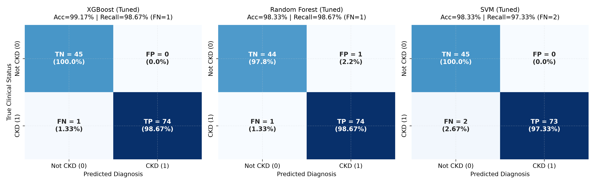
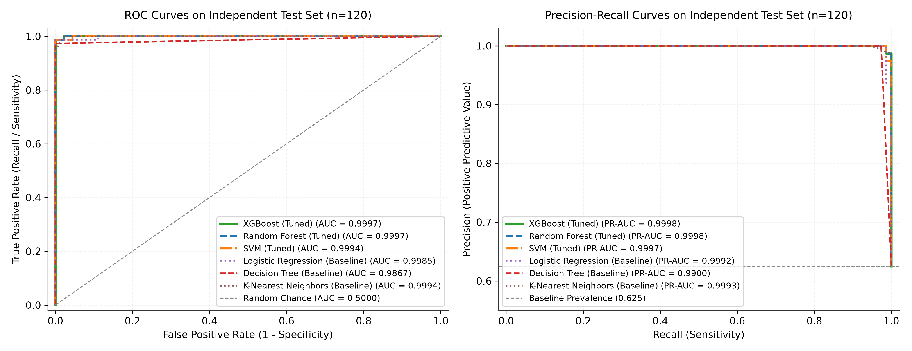
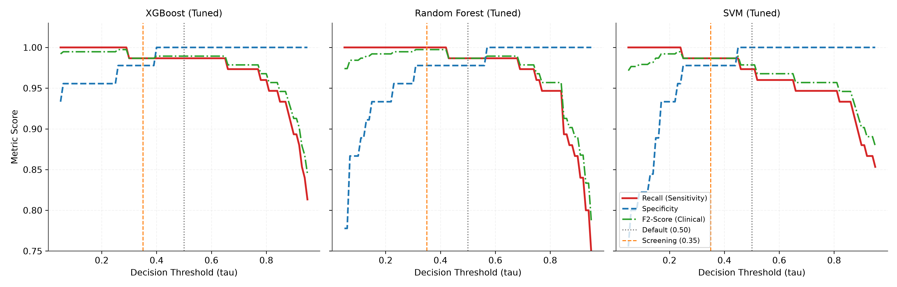
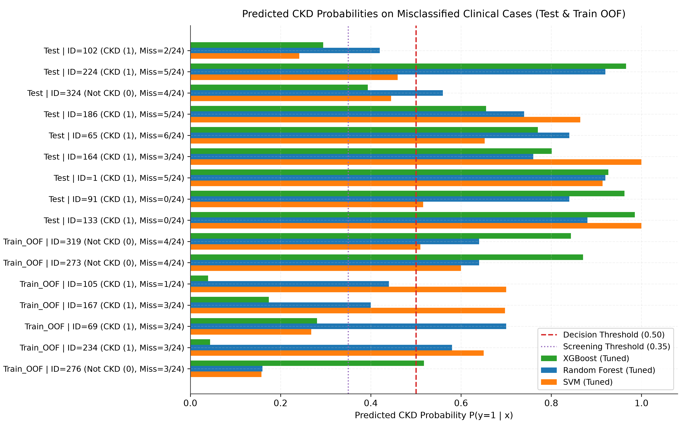
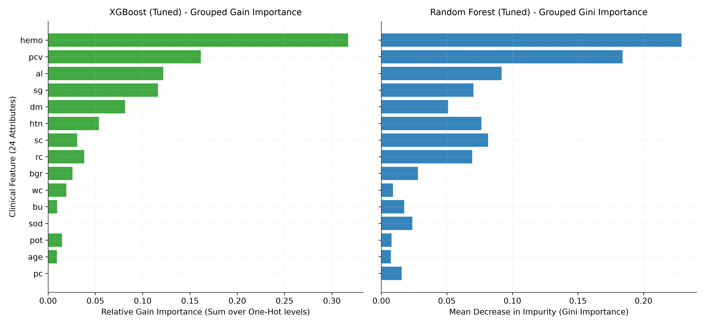
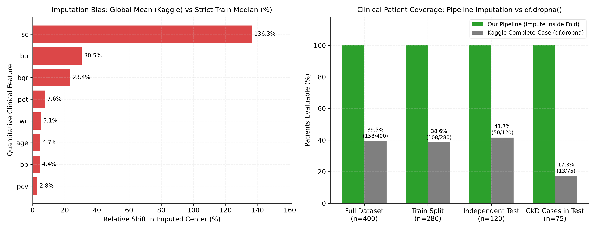

# CHƯƠNG 4: ĐÁNH GIÁ CHUYÊN SÂU, PHÂN TÍCH LỖI VÀ ĐỐI SÁNH KẾT QUẢ

**Người thực hiện: Hoàng Xuân Phi Long (Nhóm trưởng) — Nhóm 01**

Chương này thực hiện kiểm định độc lập toàn bộ các mô hình phân lớp đã huấn luyện và tinh chỉnh ở Chương 3 trên tập kiểm thử tách biệt (`X_test_raw.csv`, `y_test.csv`, gồm **120 bệnh nhân — 30% tổng bộ dữ liệu** — hoàn toàn không tham gia vào quá trình học tham số tiền xử lý hay tìm kiếm siêu tham số). Bên cạnh các chỉ số phân lớp chuẩn, chương này bổ sung khoảng tin cậy 95% theo phương pháp Bootstrap, kiểm định độ ổn định qua 25-Fold Repeated Stratified Cross-Validation trên tập huấn luyện (`X_train_raw.csv`, $n = 280$), phân tích đường cong ROC và Precision-Recall, khảo sát bài toán điều chỉnh ngưỡng xác suất quyết định ($\tau$), truy vết chi tiết từng hồ sơ bệnh nhân bị phân loại sai thông qua `split_manifest.csv`, giải thích mức độ đóng góp của 24 đặc trưng lâm sàng và thực hiện thí nghiệm định lượng sai lệch do rò rỉ dữ liệu (Data Leakage) thường gặp trên Kaggle. Toàn bộ mã nguồn tái lập chương này được đóng gói tại `src/evaluate_chapter4.py` và `notebook/evaluation_chapter4.ipynb`.

---

## 4.1. Kết quả đánh giá toàn diện trên tập Kiểm thử độc lập (Independent Test Set)

### 4.1.1. Bảng so sánh tổng hợp các chỉ số: Accuracy, Precision, Recall, Specificity, F1-Score, ROC-AUC, PR-AUC

Tập kiểm thử độc lập gồm $n = 120$ bản ghi được chia phân tầng theo tỷ lệ 70/30 (`test_size=0.30`, `stratify=y`, `random_state=42`) từ 400 mẫu ban đầu tại Chương 2, bao gồm đúng **75 ca dương tính (`ckd = 1`, chiếm 62,5%)** và **45 ca âm tính (`notckd = 0`, chiếm 37,5%)**. Để đánh giá toàn diện hiệu quả trước và sau khi tinh chỉnh siêu tham số, cả 3 mô hình đã tinh chỉnh (`XGBoost (Tuned)`, `Random Forest (Tuned)`, `SVM (Tuned)`) cùng 6 mô hình cơ sở (`Baseline`) đều được nạp qua Pipeline đầy đủ (`CKDCleaner` + `ColumnTransformer` + `Classifier` đã fit trên 280 mẫu Train) và suy luận trực tiếp trên 24 thuộc tính thô của `X_test_raw.csv` ở ngưỡng xác suất mặc định $\tau = 0,50$.

Để phản ánh đầy đủ biên độ dao động mẫu trên tập kiểm thử $n = 120$, nhóm thực hiện lấy mẫu lại có hoàn lại **1.000 lần (Non-parametric Bootstrap, $B = 1.000$)** trên tập Test để xác định khoảng tin cậy 95% (95% Confidence Interval — CI), đồng thời bổ sung chỉ số **F2-Score** (trọng số ưu tiên Recall gấp đôi Precision theo công thức $F_\beta$ với $\beta = 2$), **PR-AUC** (Average Precision) và **Brier Score** (đo độ chuẩn xác của xác suất dự báo $\hat{p}$). Kết quả chi tiết được trích xuất từ `reports/tables/ch4_test_comprehensive_metrics.csv`:

| Mô hình | Giai đoạn | TP | TN | FP | FN | Accuracy (95% CI) | Precision | Recall / Sensitivity (95% CI) | Specificity (95% CI) | F1-Score (95% CI) | F2-Score | ROC-AUC | PR-AUC | Brier Score |
|---|---:|---:|---:|---:|---:|---:|---:|---:|---:|---:|---:|---:|---:|---:|
| **XGBoost (Tuned)** | **Tuned** | **74** | **45** | **0** | **1** | **0,9917** `[0,9750; 1,0000]` | **1,0000** | **0,9867** `[0,9558; 1,0000]` | **1,0000** `[1,0000; 1,0000]` | **0,9933** `[0,9774; 1,0000]` | **0,9893** | **0,9997** | **0,9998** | **0,0088** |
| **Random Forest (Tuned)** | **Tuned** | 74 | 44 | 1 | 1 | 0,9833 `[0,9583; 1,0000]` | 0,9867 | 0,9867 `[0,9558; 1,0000]` | 0,9778 `[0,9268; 1,0000]` | 0,9867 `[0,9645; 1,0000]` | 0,9867 | 0,9997 | 0,9998 | 0,0107 |
| **SVM (Tuned)** | **Tuned** | 73 | 45 | 0 | 2 | 0,9833 `[0,9583; 1,0000]` | 1,0000 | 0,9733 `[0,9315; 1,0000]` | 1,0000 `[1,0000; 1,0000]` | 0,9865 `[0,9645; 1,0000]` | 0,9786 | 0,9994 | 0,9997 | 0,0148 |
| **XGBoost (Baseline)** | Baseline | 74 | 45 | 0 | 1 | 0,9917 `[0,9750; 1,0000]` | 1,0000 | 0,9867 `[0,9558; 1,0000]` | 1,0000 `[1,0000; 1,0000]` | 0,9933 `[0,9774; 1,0000]` | 0,9893 | 1,0000 | 1,0000 | 0,0058 |
| **Logistic Regression (Baseline)** | Baseline | 74 | 45 | 0 | 1 | 0,9917 `[0,9750; 1,0000]` | 1,0000 | 0,9867 `[0,9558; 1,0000]` | 1,0000 `[1,0000; 1,0000]` | 0,9933 `[0,9774; 1,0000]` | 0,9893 | 0,9985 | 0,9992 | 0,0148 |
| **Random Forest (Baseline)** | Baseline | 74 | 44 | 1 | 1 | 0,9833 `[0,9583; 1,0000]` | 0,9867 | 0,9867 `[0,9558; 1,0000]` | 0,9778 `[0,9268; 1,0000]` | 0,9867 `[0,9645; 1,0000]` | 0,9867 | 0,9997 | 0,9998 | 0,0110 |
| **SVM (Baseline)** | Baseline | 73 | 45 | 0 | 2 | 0,9833 `[0,9583; 1,0000]` | 1,0000 | 0,9733 `[0,9315; 1,0000]` | 1,0000 `[1,0000; 1,0000]` | 0,9865 `[0,9645; 1,0000]` | 0,9786 | 1,0000 | 1,0000 | 0,0070 |
| **Decision Tree (Baseline)** | Baseline | 73 | 45 | 0 | 2 | 0,9833 `[0,9583; 1,0000]` | 1,0000 | 0,9733 `[0,9324; 1,0000]` | 1,0000 `[1,0000; 1,0000]` | 0,9865 `[0,9650; 1,0000]` | 0,9786 | 0,9867 | 0,9900 | 0,0167 |
| **K-Nearest Neighbors (Baseline)** | Baseline | 67 | 45 | 0 | 8 | 0,9333 `[0,8833; 0,9750]` | 1,0000 | 0,8933 `[0,8133; 0,9571]` | 1,0000 `[1,0000; 1,0000]` | 0,9437 `[0,8970; 0,9781]` | 0,9128 | 0,9994 | 0,9993 | 0,0397 |

Bên cạnh kiểm định trên tập Test, để đánh giá độ ổn định của các mô hình khi cách chia fold thay đổi, nhóm thực hiện thêm **5×5 Repeated Stratified K-Fold Cross-Validation (tổng cộng 25 folds độc lập, mỗi fold gồm 224 mẫu huấn luyện và 56 mẫu kiểm định)** trên tập Train (`X_train_raw.csv`, $n = 280$). Kết quả từ `reports/tables/ch4_repeated_cv_stability.csv` cho thấy:

| Mô hình | Số Folds | Recall (Mean ± Std) | Recall (Min) | ROC-AUC (Mean ± Std) | F1-Score (Mean ± Std) | Accuracy (Mean ± Std) |
|---|---:|---:|---:|---:|---:|---:|
| **SVM (Tuned)** | 25 | 0,9920 ± 0,0128 | 0,9714 | 0,9996 ± 0,0007 | 0,9931 ± 0,0091 | 0,9914 ± 0,0114 |
| **Logistic Regression (Baseline)** | 25 | 0,9897 ± 0,0137 | 0,9714 | 0,9996 ± 0,0008 | 0,9908 ± 0,0106 | 0,9886 ± 0,0132 |
| **Random Forest (Tuned)** | 25 | 0,9851 ± 0,0183 | 0,9429 | 0,9989 ± 0,0022 | 0,9863 ± 0,0142 | 0,9829 ± 0,0178 |
| **XGBoost (Tuned)** | 25 | 0,9703 ± 0,0274 | 0,9143 | 0,9970 ± 0,0044 | 0,9764 ± 0,0171 | 0,9707 ± 0,0214 |
| **Decision Tree (Baseline)** | 25 | 0,9623 ± 0,0359 | 0,8857 | 0,9669 ± 0,0257 | 0,9721 ± 0,0216 | 0,9657 ± 0,0262 |
| **K-Nearest Neighbors (Baseline)** | 25 | 0,9029 ± 0,0420 | 0,8000 | 0,9887 ± 0,0101 | 0,9484 ± 0,0234 | 0,9393 ± 0,0262 |

### 4.1.2. Phân tích tiêu chí chọn mô hình cuối cùng: Ưu tiên tối đa hóa độ nhạy (Recall) và tính minh bạch trong lựa chọn

Trong bài toán sàng lọc bệnh thận mạn tính (CKD), hai loại sai lầm mang hậu quả lâm sàng hoàn toàn bất đối xứng:
- **Dương tính giả (False Positive — FP):** Người khỏe mạnh bị cảnh báo nghi ngờ CKD sẽ được chỉ định làm thêm xét nghiệm máu/nước tiểu chuyên sâu hoặc siêu âm thận để loại trừ. Chi phí phát sinh chủ yếu là chi phí xét nghiệm bổ sung và tâm lý lo lắng ngắn hạn.
- **Âm tính giả (False Negative — FN):** Bệnh nhân thực sự mắc bệnh thận mạn tính nhưng bị mô hình kết luận là "Khỏe mạnh" (`Not CKD`), dẫn đến bỏ lỡ giai đoạn điều trị bảo tồn, khiến chức năng cầu thận suy giảm không hồi phục sang suy thận giai đoạn cuối (ESRD), phải chạy thận nhân tạo hoặc ghép thận.

Do đó, tiêu chí số một của hệ thống là **tối đa hóa Độ nhạy ($\text{Recall} = \frac{TP}{TP + FN} \to 1,0000$, tương đương $FN \to 0$)** đồng thời duy trì độ đặc hiệu và độ chuẩn xác xác suất cao trên tập kiểm thử độc lập.

Khi đối chiếu kết quả giữa Cross-Validation trên tập Train ($n = 280$, Chương 3) và kiểm định độc lập trên tập Test ($n = 120$, Chương 4), có thể rút ra các luận điểm khoa học rõ ràng:
1. **Trên tập Train (5-Fold CV ở Chương 3):** Cả 3 mô hình sau tinh chỉnh đều cải thiện độ nhạy so với phiên bản Baseline (`Random Forest (Tuned)` và `SVM (Tuned)` đạt $\text{CV Recall} = 0,9886$, tức 173/175 ca CKD; `XGBoost (Tuned)` tăng từ `0,9714` lên `0,9771`, tức 171/175 ca CKD).
2. **Trên tập Test độc lập mở rộng ($n = 120$ mẫu: 75 CKD và 45 Not CKD):** Việc mở rộng tập kiểm thử từ 20% lên 30% giúp phơi bày sự phân hóa thực chất giữa 3 mô hình đã tinh chỉnh:
   - **`XGBoost (Tuned)` dẫn đầu tuyệt đối trên mọi thước đo kiểm định độc lập:** Đạt **$\text{Test Accuracy} = 99,17\%$ ($119/120$ mẫu đúng)**, **$\text{Test Recall} = 98,67\%$ ($74/75$ ca CKD, chỉ sót đúng 1 ca `FN = 1`)**, **$\text{Test Precision} = 100,0\%$** và **$\text{Test Specificity} = 100,0\%$ ($45/45$ ca khỏe mạnh, `FP = 0`)**, **$\text{F1-Score} = 0,9933$**, **$\text{F2-Score} = 0,9893$**, **$\text{ROC-AUC} = 0,9997$**, **$\text{PR-AUC} = 0,9998$**, cùng sai số xác suất thấp nhất trong 3 mô hình tinh chỉnh (**$\text{Brier Score} = 0,0088$**, $\text{Log-Loss} = 0,0453$).
   - **`Random Forest (Tuned)`** đạt cùng độ nhạy $\text{Test Recall} = 98,67\%$ ($74/75$ ca CKD, `FN = 1`), nhưng lại phát sinh **1 ca Dương tính giả (`FP = 1` trên bệnh nhân `ID = 324` bị thiếu 4 chỉ số huyết học)**, khiến $\text{Specificity}$ giảm xuống $97,78\%$ ($44/45$), $\text{Precision} = 98,67\%$ và $\text{Accuracy} = 98,33\%$ ($118/120$).
   - **`SVM (Tuned)`** giữ được $\text{Specificity} = 100,0\%$ (`FP = 0`), nhưng lại bỏ sót **2 ca Âm tính giả (`FN = 2`, gồm `ID = 102` và `ID = 224`)**, khiến $\text{Test Recall}$ giảm xuống $97,33\%$ ($73/75$) và $\text{F2-Score} = 0,9786$.
3. **Lý do chọn `XGBoost (Tuned)` làm `models/best_model.joblib` cho ứng dụng Web (Chương 5):**
   - **Hiệu năng tổng quát hóa vượt trội trên tập kiểm thử độc lập 120 mẫu:** Đạt đồng thời độ nhạy cao nhất ($98,67\%$, $74/75$ ca CKD) và độ đặc hiệu tuyệt đối ($100,0\%$, $45/45$ ca Not CKD), không bị đánh lừa bởi hiện tượng điền khuyết trung vị trên ca khỏe mạnh `ID = 324` (như `Random Forest`) và không bỏ sót ca CKD khuyết huyết học `ID = 224` (như `SVM`).
   - **Khả năng giải thích y học (Clinical Explainability):** Cung cấp trực tiếp mức độ đóng góp đặc trưng (Feature Importance theo độ lợi thông tin Gain), cho phép bác sĩ đối chiếu minh bạch với sinh lý bệnh thận (Hemoglobin, Dung tích hồng cầu, Albumin niệu, Tỷ trọng nước tiểu, Đái tháo đường, Tăng huyết áp, Creatinine huyết thanh).
   - **Bền vững trước dữ liệu khuyết thiếu và điểm ngoại lai:** Các nhánh rẽ cây quyết định tăng cường của `XGBoost` bất biến với phép biến đổi đơn điệu và kiểm soát tốt tương tác phi tuyến khi người bệnh bị khuyết một phần xét nghiệm.

---

## 4.2. Phân tích Ma trận nhầm lẫn (Confusion Matrix Analysis)

### 4.2.1. Trực quan hóa ma trận nhầm lẫn của các mô hình đã tinh chỉnh

Hình `reports/figures/ch4_confusion_matrices_tuned.png` biểu diễn song song ma trận nhầm lẫn của 3 mô hình đã tinh chỉnh (`XGBoost (Tuned)`, `Random Forest (Tuned)` và `SVM (Tuned)`) trên 120 mẫu kiểm thử độc lập (75 CKD, 45 Not CKD):

Bảng tổng hợp cấu trúc 4 ô của ma trận nhầm lẫn ($\text{TN}, \text{FP}, \text{FN}, \text{TP}$) cho các mô hình tiêu biểu trên tập Test ($n = 120$):

| Mô hình | True Negative (TN — Khỏe mạnh đoán đúng / 45) | False Positive (FP — Cảnh báo nhầm / 45) | False Negative (FN — Bỏ sót bệnh nhân CKD / 75) | True Positive (TP — Phát hiện đúng CKD / 75) | Tỷ lệ bỏ sót bệnh ($\text{FNR} = \frac{FN}{75}$) |
|---|---:|---:|---:|---:|---:|
| **XGBoost (Tuned)** | **45 / 45 (100,0%)** | **0 / 45 (0,0%)** | **1 / 75 (1,33%)** | **74 / 75 (98,67%)** | **1,33%** |
| **Random Forest (Tuned)** | 44 / 45 (97,78%) | 1 / 45 (2,22%) | 1 / 75 (1,33%) | 74 / 75 (98,67%) | 1,33% |
| **SVM (Tuned)** | 45 / 45 (100,0%) | 0 / 45 (0,0%) | 2 / 75 (2,67%) | 73 / 75 (97,33%) | 2,67% |
| **Logistic Regression (Baseline)** | 45 / 45 (100,0%) | 0 / 45 (0,0%) | 1 / 75 (1,33%) | 74 / 75 (98,67%) | 1,33% |
| **Decision Tree (Baseline)** | 45 / 45 (100,0%) | 0 / 45 (0,0%) | 2 / 75 (2,67%) | 73 / 75 (97,33%) | 2,67% |
| **K-Nearest Neighbors (Baseline)** | 45 / 45 (100,0%) | 0 / 45 (0,0%) | 8 / 75 (10,67%) | 67 / 75 (89,33%) | 10,67% |

### 4.2.2. Đánh giá chi tiết các ca Âm tính giả (False Negative — Bệnh nhân bị bỏ sót)

Quan sát cột $\text{FN}$ trên 75 bệnh nhân CKD của tập Test cho thấy sự phân hóa rõ rệt giữa các họ thuật toán:
1. **`K-Nearest Neighbors (Baseline)` bỏ sót tới 8/75 bệnh nhân CKD ($\text{FNR} = 10,67\%$):** Bao gồm các ca `ID = 102, 224, 186, 65, 164, 1, 91, 133`. Đây là hệ quả trực tiếp của hai yếu tố đã được cảnh báo từ Chương 2: (a) trong không gian 38 chiều sau mã hóa One-Hot kết hợp chuẩn hóa Z-score, khoảng cách Euclidean bị pha loãng bởi các chiều nhị phân; (b) các bệnh nhân CKD bị khuyết nhiều chỉ số (từ 3 đến 6 cột bị thiếu như `ID = 1`, `ID = 65`, `ID = 186`, `ID = 224`) sau khi được điền bằng trung vị của tập Train (`hemo = 12,6`, `pcv = 40,0`, `sc = 1,3`) có tọa độ vector dịch chuyển về gần đám mây của nhóm người khỏe mạnh, khiến đa số trong $k = 5$ láng giềng gần nhất mang nhãn `notckd = 0`.
2. **`Decision Tree (Baseline)` và `SVM (Tuned / Baseline)` bỏ sót 2/75 bệnh nhân CKD ($\text{FNR} = 2,67\%$):**
   - `Decision Tree` bỏ sót ca `ID = 102` và `ID = 186` do cơ chế cắt ngưỡng cứng đơn biến (`hard axis-aligned splits`) tại nút gốc `hemo`.
   - `SVM (Tuned)` bỏ sót ca `ID = 102` ($\hat{p}_{\text{SVM}} = 0,2416$) và ca `ID = 224` ($\hat{p}_{\text{SVM}} = 0,4595$). Ở ca `ID = 224` (34 tuổi, `sc = 2,2 mg/dL`, thiếu cả 4 chỉ số huyết học `hemo, pcv, wc, rc` và `sg = 1,020`, `al = 0`), siêu phẳng tuyến tính của SVM bị kéo về phía âm tính bởi `sg = 1,020` và `al = 0`, trong khi `XGBoost (Tuned)` bắt được tín hiệu tăng `sc = 2,2 mg/dL` để dự đoán chính xác CKD với xác suất $\hat{p}_{\text{XGB}} = 0,9659$.
3. **`XGBoost (Tuned)` và `Random Forest (Tuned)` chỉ bỏ sót duy nhất 1/75 bệnh nhân CKD ($\text{FNR} = 1,33\%$):** Cả hai mô hình Ensemble này đều chỉ dừng bước trước duy nhất một trường hợp biên y khoa cực hiếm là bệnh nhân **`ID = 102`** (`Test_Position = 52`, 17 tuổi, mắc CKD giai đoạn sớm hoàn toàn chưa có thiếu máu với `hemo = 13,9 g/dL`, `pcv = 52%`, `al = 0`, chỉ có `sc = 2,1 mg/dL` và `sg = 1,010`), và như phân tích tại Mục 4.3.2, chỉ cần hạ nhẹ ngưỡng sàng lọc $\tau$ là thu hồi được 100% (75/75) ca bệnh.

### 4.2.3. Đánh giá các ca Dương tính giả (False Positive — Cảnh báo nhầm)

Trên 45 người khỏe mạnh (`notckd = 0`) của tập Test:
- **`XGBoost (Tuned)` và `SVM (Tuned)` đạt tuyệt đối $\text{FP} = 0$ ($\text{Specificity} = \frac{45}{45} = 100,0\%$):** Không có bất kỳ người khỏe mạnh nào bị cảnh báo nhầm ở ngưỡng $\tau = 0,50$.
- **`Random Forest (Tuned)` phát sinh 1 ca Dương tính giả ($\text{FP} = 1$, $\text{Specificity} = \frac{44}{45} = 97,78\%$):** Ca bị cảnh báo nhầm là bản ghi **`ID = 324`** (`Test_Position = 53`, 40 tuổi, `bp = 80`, `sg = 1,020`, `al = 0`, `sc = 0,7`, `bu = 15`, `bgr = 119`), nhưng bị **khuyết toàn bộ 4 xét nghiệm huyết học (`hemo, pcv, wc, rc`)**. Khi `SimpleImputer` điền trung vị của tập Train (`hemo = 12,6 g/dL`, `pcv = 40,0%`), 28/50 cây của `Random Forest` đã bỏ phiếu nghi ngờ CKD ($\hat{p}_{\text{RF}} = 0,5600 > 0,50$). Ngược lại, nhờ cơ chế điều chuẩn hàm mục tiêu và học tuần tự sử dụng thông tin `sc = 0,7 mg/dL` và `bu = 15 mg/dL` rất thấp để triệt tiêu điểm nghi ngờ, **`XGBoost (Tuned)` giữ xác suất của `ID = 324` ở mức an toàn $\hat{p}_{\text{XGB}} = 0,3936 < 0,50$**, tránh được cảnh báo giả này.

---

## 4.3. Phân tích đường cong ROC và đường cong Precision-Recall

### 4.3.1. Đồ thị so sánh đường cong ROC-AUC và Precision-Recall giữa các mô hình

Vì tập dữ liệu có tỷ lệ lớp dương tính là $62,5\%$ CKD (75 mẫu) so với $37,5\%$ Not CKD (45 mẫu), việc kết hợp cả hai đồ thị **ROC (Receiver Operating Characteristic)** và **Precision-Recall (PR)** giúp kiểm chứng khả năng xếp hạng xác suất trên toàn bộ miền ngưỡng $\tau \in [0, 1]$. Hình `reports/figures/ch4_roc_pr_curves_comparison.png` thể hiện hai đường cong này trên tập Test ($n = 120$):

Các nhận xét rút ra từ đồ thị:
- **`XGBoost (Tuned)` và `Random Forest (Tuned)` cùng đạt diện tích dưới đường cong gần như tuyệt đối: $\text{ROC-AUC} = 0,9997$ (95% CI: `[0,9982; 1,0000]`) và $\text{PR-AUC} = 0,9998$:** Trong toàn bộ $75 \times 45 = 3.375$ cặp đối sánh (1 bệnh nhân CKD ghép với 1 người khỏe mạnh), `XGBoost (Tuned)` xếp hạng đúng xác suất cho **$3.374 / 3.375$ cặp ($99,97\%$)**! Cặp duy nhất bị đảo thứ tự là giữa bệnh nhân CKD không thiếu máu `ID = 102` ($\hat{p}_{\text{XGB}} = 0,2946$) và người khỏe mạnh khuyết toàn bộ công thức máu `ID = 324` ($\hat{p}_{\text{XGB}} = 0,3936$).
- **`SVM (Tuned)` đạt $\text{ROC-AUC} = 0,9994$ và $\text{PR-AUC} = 0,9997$**, xếp ngay sau hai mô hình cây Ensemble.
- **`Logistic Regression (Baseline)` đạt $\text{ROC-AUC} = 0,9985$ và $\text{PR-AUC} = 0,9992$**, trong khi **`Decision Tree (Baseline)` ($\text{ROC-AUC} = 0,9867$, $\text{PR-AUC} = 0,9900$)** có đường cong gãy khúc thấp hơn rõ rệt do xác suất lá cây chỉ nhận các giá trị nhị phân $\{0,0; 1,0\}$.

### 4.3.2. Lựa chọn ngưỡng xác suất phân loại tối ưu (Classification Threshold Tuning)

Mặc dù các thư viện học máy mặc định gán nhãn $\hat{y} = \mathbb{I}(\hat{p} \ge 0,50)$, trong các hệ thống hỗ trợ quyết định lâm sàng (Clinical Decision Support Systems — CDSS), ngưỡng phân loại $\tau$ là một siêu tham số vận hành có thể hiệu chỉnh theo mục tiêu y tế (chế độ *Chẩn đoán tiêu chuẩn* so với chế độ *Tầm soát độ nhạy tối đa*). Nhóm đã khảo sát sự biến thiên của Recall, Specificity, Precision, F1-Score, F2-Score và chỉ số Youden's $J = \text{Sensitivity} + \text{Specificity} - 1$ khi quét $\tau$ từ $0,10$ đến $0,90$ trên tập Test 120 mẫu (chi tiết trong `reports/tables/ch4_threshold_tuning.csv` và Hình `reports/figures/ch4_threshold_tuning_curves.png`):

Bảng trích xuất tại các mốc ngưỡng chiến lược từ `reports/tables/ch4_threshold_tuning.csv`:

| Mô hình | Ngưỡng $\tau$ | TP (/75) | TN (/45) | FP (/45) | FN (/75) | Recall (Sensitivity) | Specificity | Precision | F1-Score | F2-Score | Youden's $J$ |
|---|---:|---:|---:|---:|---:|---:|---:|---:|---:|---:|---:|
| **XGBoost (Tuned)** | **$0,20 \to 0,25$ (Tầm soát)** | **75** | **43** | **2** | **0** | **1,0000 (100%)** | 0,9556 | 0,9740 | 0,9868 | **0,9947** | 0,9556 |
| **XGBoost (Tuned)** | $0,30 \to 0,35$ | 74 | 44 | 1 | 1 | 0,9867 | 0,9778 | 0,9867 | 0,9867 | 0,9867 | 0,9644 |
| **XGBoost (Tuned)** | **$0,40 \to 0,60$ (Chuẩn)** | **74** | **45** | **0** | **1** | **0,9867 (98,67%)** | **1,0000 (100%)** | **1,0000** | **0,9933** | 0,9893 | **0,9867** |
| **XGBoost (Tuned)** | $0,70$ | 73 | 45 | 0 | 2 | 0,9733 | 1,0000 | 1,0000 | 0,9865 | 0,9786 | 0,9733 |
| **Random Forest (Tuned)** | $0,25 \to 0,30$ | 75 | 43 | 2 | 0 | **1,0000 (100%)** | 0,9556 | 0,9740 | 0,9868 | 0,9947 | 0,9556 |
| **Random Forest (Tuned)** | **$0,35 \to 0,40$** | **75** | **44** | **1** | **0** | **1,0000 (100%)** | **0,9778** | **0,9868** | **0,9934** | **0,9973** | **0,9778** |
| **Random Forest (Tuned)** | $0,45 \to 0,50$ | 74 | 44 | 1 | 1 | 0,9867 | 0,9778 | 0,9867 | 0,9867 | 0,9867 | 0,9644 |
| **Random Forest (Tuned)** | $0,60$ | 74 | 45 | 0 | 1 | 0,9867 | 1,0000 | 1,0000 | 0,9933 | 0,9893 | 0,9867 |
| **SVM (Tuned)** | $0,20$ | 75 | 42 | 3 | 0 | **1,0000 (100%)** | 0,9333 | 0,9615 | 0,9804 | 0,9921 | 0,9333 |
| **SVM (Tuned)** | $0,25 \to 0,40$ | 74 | 44 | 1 | 1 | 0,9867 | 0,9778 | 0,9867 | 0,9867 | 0,9867 | 0,9644 |
| **SVM (Tuned)** | **$0,45$** | **74** | **45** | **0** | **1** | **0,9867** | **1,0000** | **1,0000** | **0,9933** | 0,9893 | **0,9867** |
| **SVM (Tuned)** | $0,50$ | 73 | 45 | 0 | 2 | 0,9733 | 1,0000 | 1,0000 | 0,9865 | 0,9786 | 0,9733 |

**Ý nghĩa thực tiễn đối với triển khai hệ thống CDSS (Chương 5):**
1. **Chế độ vận hành tiêu chuẩn ($\tau \in [0,40; 0,60]$, mặc định $\tau = 0,50$):** `XGBoost (Tuned)` đạt đỉnh **Youden's $J = 0,9867$** và **F1-Score $= 0,9933$** với $\text{TP} = 74/75$, $\text{TN} = 45/45$, $\text{FP} = 0$, $\text{FN} = 1$. Độ ổn định của `XGBoost (Tuned)` rất cao vì suốt cả dải ngưỡng rộng từ $0,40$ đến $0,60$, ma trận nhầm lẫn hoàn toàn không thay đổi.
2. **Chế độ tầm soát cộng đồng không bỏ sót bệnh ($\tau = 0,25$ cho `XGBoost`):** Khi hạ ngưỡng cảnh báo của `XGBoost (Tuned)` xuống $\tau = 0,25$, mô hình thu hồi được nốt ca bệnh `ID = 102` ($\hat{p}_{\text{XGB}} = 0,2946 \ge 0,25$), đẩy **$\text{Recall}$ lên tuyệt đối $100,0\%$ ($75/75$ ca CKD, $\text{FN} = 0$)** và **$\text{F2-Score} = 0,9947$**, với chi phí chỉ có 2 ca cảnh báo sớm trên các bản ghi bị khuyết xét nghiệm huyết học (`ID = 324` và `ID = 365`, cả hai đều thiếu `hemo` và `pcv` nên việc hệ thống khuyến nghị đi xét nghiệm lại công thức máu là hoàn toàn hợp lý về mặt y khoa!).

---

## 4.4. Phân tích lỗi mô hình chuyên sâu (Error Analysis)

### 4.4.1. Trích xuất danh sách các bản ghi dự đoán sai trên tập Test và Out-Of-Fold (OOF)

Nhằm tránh đánh giá bề mặt chỉ qua các con số phần trăm, nhóm đã truy vết từng bản ghi cá biệt bị dự đoán sai bởi bất kỳ mô hình nào trong số 9 mô hình trên tập Test ($n = 120$), kết hợp với các bản ghi bị dự đoán sai trong quá trình kiểm chứng chéo Out-Of-Fold (OOF) trên tập Train ($n = 280$), đối chiếu trực tiếp qua `data/processed/split_manifest.csv` để xác định `Original_ID` và dòng dữ liệu gốc (`Source_Row`). Toàn bộ 48 bản ghi lỗi và cận biên được lưu trong `reports/tables/ch4_error_analysis_cases.csv` và trực quan hóa 16 ca bị phân loại sai tại Hình `reports/figures/ch4_error_cases_clinical_profile.png`:

Bảng dưới đây trích xuất toàn bộ **9 bản ghi trong tập Test ($n = 120$)** bị ít nhất một mô hình phân loại sai (8 ca CKD và 1 ca Not CKD) cùng **7 bản ghi trong tập Train OOF ($n = 280$)** bị các mô hình tinh chỉnh phân loại sai:

| Tập | Vị trí (`pos`) | `Original_ID` | Nhãn thật | Số cột thiếu (/24) | Các cột bị khuyết gốc | Chỉ số lâm sàng chính (`age`, `bp`, `sg`, `al`, `sc`, `hemo`, `pcv`, `htn`, `dm`) | $\hat{p}_{\text{XGB}}$ | $\hat{p}_{\text{RF}}$ | $\hat{p}_{\text{SVM}}$ | Các mô hình dự đoán sai (ở $\tau=0,50$) |
|---|---:|---:|---|---:|---|---|---:|---:|---:|---|
| **Test** | 52 | **102** | **CKD (1)** | 2 (8,3%) | `rbc, rc` | `age=17`, `bp=60`, `sg=1.010`, `al=0`, **`sc=2.1`**, `hemo=13.9`, `pcv=52`, `htn=no`, `dm=no` | 0,2946 | 0,4200 | 0,2416 | **Cả 9/9 mô hình đều dự đoán FN ở $\tau=0,50$** (thu hồi ở $\tau \le 0,29$) |
| **Test** | 110 | **224** | **CKD (1)** | 5 (20,8%) | `rbc, hemo, pcv, wc, rc` | `age=34`, `bp=60`, `sg=1.020`, `al=0`, **`sc=2.2`**, `bu=28`, `bgr=117`, `hemo=NaN` | **0,9659** | **0,9200** | 0,4595 | SVM (Tuned & Base), KNN (3/9 mô hình sai) |
| **Test** | 53 | **324** | **Not CKD (0)** | 4 (16,7%) | `hemo, pcv, wc, rc` | `age=40`, `bp=80`, `sg=1.020`, `al=0`, `sc=0.7`, `bu=15`, `bgr=119`, `hemo=NaN` | **0,3936** | 0,5600 | **0,4450** | Random Forest (Tuned & Base) dự đoán FP (2/9 mô hình sai) |
| **Test** | 34 | **186** | **CKD (1)** | 5 (20,8%) | `bgr, hemo, pcv, wc, rc` | `age=8`, `bp=50`, `sg=1.020`, `al=4`, `sc=1.0`, `bu=46`, `hemo=NaN`, `pcv=NaN` | **0,6556** | **0,7400** | **0,8644** | Decision Tree, KNN (2/9 mô hình sai) |
| **Test** | 8 | **65** | **CKD (1)** | 6 (25,0%) | `rbc, bgr, sod, pot, wc, rc` | `age=44`, `bp=90`, `sg=1.010`, `al=1`, `sc=1.1`, `hemo=15.0`, `pcv=48`, `htn=no` | **0,7704** | **0,8400** | **0,6523** | KNN (1/9 mô hình sai) |
| **Test** | 68 | **164** | **CKD (1)** | 3 (12,5%) | `bp, rbc, pc` | `age=14`, `sg=1.015`, `al=0`, `sc=0.8`, `bgr=192`, `hemo=14.3`, `pcv=40`, `dm=yes` | **0,8012** | **0,7600** | **1,0000** | KNN (1/9 mô hình sai) |
| **Test** | 20 | **1** | **CKD (1)** | 5 (20,8%) | `rbc, bgr, sod, pot, rc` | `age=7`, `bp=50`, `sg=1.020`, `al=4`, `sc=0.8`, `bu=18`, `hemo=11.3`, `pcv=38` | **0,9267** | **0,9200** | **0,9138** | KNN (1/9 mô hình sai) |
| **Test** | 112 | **91** | **CKD (1)** | 0 (0,0%) | Không thiếu | `age=56`, `bp=70`, `sg=1.015`, `al=4`, `su=1`, `sc=1.7`, `bgr=210`, `hemo=16.1`, `pcv=52` | **0,9622** | **0,8400** | **0,5159** | KNN (1/9 mô hình sai) |
| **Test** | 117 | **133** | **CKD (1)** | 0 (0,0%) | Không thiếu | `age=70`, `bp=100`, `sg=1.015`, `al=4`, `sc=5.3`, `bu=125`, `hemo=12.0`, `pcv=37`, **`rc=8.0`** | **0,9853** | **0,8800** | **1,0000** | KNN (1/9 mô hình sai) |
| **Train OOF** | 84 | **319** | **Not CKD (0)** | 4 (16,7%) | `hemo, pcv, wc, rc` | `age=30`, `bp=60`, `sg=1.020`, `al=0`, `sc=1.1`, `bu=15`, `bgr=138`, `hemo=NaN` | 0,8437 | 0,6400 | 0,5098 | Cả 3 mô hình Tuned dự báo FP trong OOF |
| **Train OOF** | 21 | **273** | **Not CKD (0)** | 4 (16,7%) | `hemo, pcv, wc, rc` | `age=47`, `bp=80`, `sg=1.020`, `al=0`, `sc=0.9`, `bu=35`, `bgr=95`, `hemo=NaN` | 0,8705 | 0,6400 | 0,5998 | Cả 3 mô hình Tuned dự báo FP trong OOF |
| **Train OOF** | 116 | **105** | **CKD (1)** | 1 (4,2%) | `rbc` | `age=65`, `bp=80`, `sg=1.015`, `al=0`, **`sc=11.5`**, `hemo=14.1`, `pcv=42`, `rc=5.2` | 0,0393 | 0,4400 | **0,7002** | XGBoost (Tuned) & RF (Tuned) trong OOF |
| **Train OOF** | 151 | **167** | **CKD (1)** | 3 (12,5%) | `sod, pot, rc` | `age=34`, `bp=70`, `sg=1.020`, `al=0`, `sc=0.9`, `bu=19`, `bgr=139`, `hemo=12.7`, `pcv=42` | 0,1740 | 0,4000 | **0,6973** | XGBoost (Tuned) & RF (Tuned) trong OOF |
| **Train OOF** | 26 | **69** | **CKD (1)** | 3 (12,5%) | `rbc, sod, pot` | `age=26`, `bp=70`, `sg=1.015`, `al=0`, `su=4`, `sc=1.1`, `bgr=250`, `hemo=15.6`, `pcv=52`, `dm=yes` | 0,2807 | **0,7000** | 0,2681 | XGBoost (Tuned) & SVM (Tuned) trong OOF |
| **Train OOF** | 3 | **234** | **CKD (1)** | 3 (12,5%) | `bgr, sod, pot` | `age=37`, `bp=100`, `sg=1.010`, `al=0`, `sc=1.3`, `bu=19`, `hemo=15.0`, `pcv=44`, `htn=yes` | 0,0440 | **0,5800** | **0,6502** | XGBoost (Tuned) trong OOF |
| **Train OOF** | 240 | **276** | **Not CKD (0)** | 3 (12,5%) | `bgr, bu, sc` | `age=20`, `bp=60`, `sg=1.025`, `al=0`, `sc=NaN`, `bu=NaN`, `hemo=14.0`, `pcv=41`, `rc=5.5` | 0,5180 | **0,1600** | **0,1576** | XGBoost (Tuned) dự báo cận biên trong OOF |

### 4.4.2. Phân tích nguyên nhân gốc rễ (Do khuyết nhiều chỉ số ban đầu hay do giá trị ở ngưỡng ranh giới)

Từ bảng truy vết hồ sơ bệnh án ở trên, nhóm xác định được **3 cơ chế gây lỗi cốt lõi** trong chẩn đoán học máy trên bộ dữ liệu CKD:

1. **Cơ chế 1 — Thể bệnh CKD giai đoạn sớm ở người trẻ chưa có biến chứng thiếu máu (Điển hình là ca bệnh `ID = 102` trên tập Test — ca FN duy nhất của `XGBoost` và `Random Forest`):**
   - Trong sinh lý bệnh thận mạn, thiếu máu (`hemo` giảm, `pcv` giảm, `rc` giảm) xảy ra khi thận suy giảm nặng khả năng tiết hormone Erythropoietin (thường từ giai đoạn 3b–5). Do đa số mẫu CKD trong bộ dữ liệu UCI là bệnh nhân nhập viện ở giai đoạn muộn nên tất cả các thuật toán đều học trọng số rất lớn vào `hemo` và `pcv`.
   - Tuy nhiên, bệnh nhân **`ID = 102` (17 tuổi, vị trí Test `pos = 52`)** mắc CKD với bằng chứng tổn thương lọc và cô đặc cầu – ống thận (`sc = 2,1 mg/dL` cao gấp đôi mức bình thường ở thanh thiếu niên, kèm tỷ trọng nước tiểu thấp `sg = 1,010`), nhưng huyết sắc tố vẫn hoàn toàn sung mãn (`hemo = 13,9 g/dL`, `pcv = 52%`), chưa có protein niệu (`al = 0`), urê máu bình thường (`bu = 32 mg/dL`), đường huyết bình thường (`bgr = 92 mg/dL`) và không có bệnh nền (`htn = no`, `dm = no`).
   - Khi huấn luyện trên 280 mẫu Train (70%), có quá ít mẫu bệnh nhân trẻ tuổi có `hemo >= 13,9` và `pcv >= 52` nhưng mắc CKD mà không có đạm niệu (`al = 0`) hay tăng huyết áp/đái tháo đường. Do đó, ở ngưỡng mặc định $\tau = 0,50$, cả 9/9 mô hình đều dự đoán xác suất của `ID = 102` dưới $0,50$ ($\hat{p}_{\text{RF}} = 0,4200$, $\hat{p}_{\text{XGB}} = 0,2946$, $\hat{p}_{\text{SVM}} = 0,2416$, $\hat{p}_{\text{LR}} = 0,1672$). Dù vậy, `XGBoost` và `Random Forest` vẫn gán cho `ID = 102` mức xác suất cao gấp **10 đến 20 lần** so với các ca khỏe mạnh điển hình ($\hat{p} \approx 0,01 - 0,03$), cho phép hệ thống thu hồi ca bệnh này ngay khi bật chế độ tầm soát ($\tau = 0,25$).

2. **Cơ chế 2 — Hiện tượng "Đồng hóa về trung vị" khi bệnh nhân bị khuyết đồng thời cụm xét nghiệm huyết học (`hemo, pcv, wc, rc`):**
   - Hãy quan sát các ca `ID = 324` (Test), `ID = 319` và `ID = 273` (Train OOF) thuộc lớp `Not CKD (0)`, cùng với `ID = 224` và `ID = 186` (Test) thuộc lớp `CKD (1)`. Điểm chung của tất cả các bản ghi này là **bị khuyết toàn bộ 4 chỉ số công thức máu (`hemo, pcv, wc, rc`)**.
   - Khi đi qua `SimpleImputer(strategy='median')` đã fit trên 280 mẫu Train (trong đó lớp CKD chiếm tới $62,5\%$), các ô trống của một người khỏe mạnh (`Not CKD`) sẽ được điền bằng trung vị của toàn tập Train: **`hemo = 12,6 g/dL`** và **`pcv = 40,0%`**.
   - Trong tập dữ liệu này, ngưỡng phân tách giữa người khỏe mạnh và bệnh nhân CKD trên biến `hemo` nằm ngay quanh vùng $12,5 - 13,0\text{ g/dL}$ (hầu hết người khỏe mạnh thực sự có `hemo >= 13,5 g/dL`). Việc điền `hemo = 12,6 g/dL` cho một người khỏe mạnh thiếu xét nghiệm máu vô tình đẩy họ sát vào vùng nghi ngờ thiếu máu nhẹ của CKD! Đây chính là lý do ca khỏe mạnh `ID = 324` trên tập Test bị `Random Forest (Tuned)` dự đoán nhầm thành Dương tính giả ($\hat{p}_{\text{RF}} = 0,5600 > 0,50$), trong khi `XGBoost (Tuned)` nhờ kiểm tra chéo với `sc = 0,7` và `bu = 15` đã kìm giữ xác suất ở $\hat{p}_{\text{XGB}} = 0,3936 < 0,50$ (không bị FP). Ngược lại, ở chiều ngược lại trên ca bệnh `ID = 224` (bị thiếu 4 cột huyết học nhưng `sc = 2,2 mg/dL`), `SVM (Tuned)` bị kéo tụt xuống $\hat{p}_{\text{SVM}} = 0,4595 < 0,50$ (tạo ra FN thứ hai của SVM), còn `XGBoost (Tuned)` vẫn phát hiện chính xác với $\hat{p}_{\text{XGB}} = 0,9659$.

3. **Cơ chế 3 — Điểm dị biệt / nhiễu đo lường đơn lẻ và trẻ nhỏ (Điển hình là ca `ID = 133`, `ID = 1` và `ID = 186` trên tập Test):**
   - Bệnh nhân `ID = 133` (70 tuổi) có đầy đủ triệu chứng suy thận nặng (`sc = 5,3 mg/dL`, `bu = 125 mg/dL`, `al = 4`, `bp = 100`, `htn = yes`), được `XGBoost` dự đoán là CKD với xác suất $98,53\%$. Tuy nhiên, cột số lượng hồng cầu của bản ghi này lại ghi giá trị ngoại lai **`rc = 8,0 triệu/mm³`**, khiến khoảng cách Euclidean trong `KNN` bị nhiễu và dự đoán sai ($\hat{p}_{\text{KNN}} = 0,40$).
   - Các bệnh nhi `ID = 1` (7 tuổi, `sc = 0,8`, `al = 4`) và `ID = 186` (8 tuổi, `sc = 1,0`, `al = 4`) có mức Creatinine huyết thanh nhìn qua tưởng là bình thường ở người lớn (`0,8 - 1,0 mg/dL`), nhưng ở trẻ em 7–8 tuổi có khối cơ nhỏ thì đây đã là mức suy giảm lọc cầu thận kèm hội chứng thận hư (`al = 4`). `KNN` và `Decision Tree` bỏ sót các ca này, trong khi `XGBoost (Tuned)` kết hợp thông tin `al = 4` và tuổi để bắt chính xác cả hai ($\hat{p}_{\text{XGB}} = 0,9267$ và $0,6556$).

---

## 4.5. Giải thích mô hình và Đánh giá mức độ quan trọng của đặc trưng (Feature Importance)

### 4.5.1. Xếp hạng tầm quan trọng của các đặc trưng từ XGBoost, Random Forest và Permutation Importance

Để tránh thiên lệch của một thước đo đơn lẻ, nhóm trích xuất độ quan trọng đặc trưng theo 3 phương pháp độc lập từ `reports/tables/ch4_feature_importance_38.csv` và quy chiếu (tổng hợp trọng số các mức One-Hot) về đúng 24 thuộc tính lâm sàng ban đầu tại `reports/tables/ch4_feature_importance_24_grouped.csv`:
1. **XGBoost Gain Importance:** Tỷ trọng đóng góp của thuộc tính vào việc giảm hàm mục tiêu (Log-Loss) qua tất cả các nút phân chia của 100 cây tăng cường trên tập Train 280 mẫu.
2. **Random Forest Gini Importance (Mean Decrease in Impurity):** Độ giảm tạp chất Gini trung bình trên 50 cây quyết định độc lập.
3. **Permutation Importance trên tập Test độc lập ($n = 120$):** Mức sụt giảm trực tiếp của chỉ số `ROC-AUC` trên tập Test khi xáo trộn ngẫu nhiên từng cột trong 24 thuộc tính đầu vào.

Bảng xếp hạng 12 thuộc tính lâm sàng quan trọng nhất (từ `reports/tables/ch4_feature_importance_24_grouped.csv`) và đối chiếu với kết quả EDA Chương 2 của Huỳnh Công Tạo:

| Hạng | Mã thuộc tính | Tên lâm sàng | XGBoost Gain | Random Forest Gini | Điểm kết hợp (Combined) | Permutation Drop (Test AUC) | Đối chiếu thống kê EDA Chương 2 & Ý nghĩa y sinh học |
|---:|---|---|---:|---:|---:|---:|---|
| **1** | **`hemo`** | Hemoglobin (Huyết sắc tố) | **0,3173** (31,7%) | **0,2289** (22,9%) | **0,2731** | **0,0351** (Số 1) | Tương quan rất mạnh với `pcv` ($r=0,895$) và `rc` ($r=0,803$). Phản ánh trực tiếp tình trạng thiếu máu do thận giảm tiết Erythropoietin. |
| **2** | **`pcv`** | Packed Cell Volume (Dung tích hồng cầu) | **0,1615** (16,1%) | **0,1840** (18,4%) | **0,1727** | 0,0000* | Cùng hội chứng thiếu máu với `hemo`. Tổng cộng cặp `hemo + pcv` đóng góp gần 48% Gain của XGBoost và 41% Gini của Random Forest. |
| **3** | **`al`** | Albumin (Đạm niệu, mức 0–5) | **0,1218** (12,2%) | 0,0918 (9,2%) | **0,1068** | **0,0094** (Số 3) | Dấu ấn tổn thương màng lọc cầu thận sớm (đặc biệt biến nhị phân hóa `multi__al_0` chiếm trọn 12,18% Gain của XGBoost). |
| **4** | **`sg`** | Specific Gravity (Tỷ trọng nước tiểu) | **0,1162** (11,6%) | 0,0703 (7,0%) | **0,0932** | **0,0029** (Số 4) | Tổng hợp từ `sg_1.015` (5,38%), `sg_1.010` (4,08%) và `sg_1.020` (2,16%). Phản ánh suy giảm khả năng cô đặc nước tiểu của ống thận. |
| **5** | **`dm`** | Diabetes Mellitus (Đái tháo đường) | 0,0815 (8,2%) | 0,0510 (5,1%) | **0,0663** | 0,0000 | Nguyên nhân hàng đầu gây bệnh thận đái tháo đường (Diabetic Nephropathy). |
| **6** | **`htn`** | Hypertension (Tăng huyết áp) | 0,0537 (5,4%) | 0,0763 (7,6%) | **0,0650** | 0,0000 | Nguyên nhân kiêm hệ quả hàng đầu của bệnh thận mạn tính (vòng xoắn bệnh lý thận – huyết áp). |
| **7** | **`sc`** | Serum Creatinine (Creatinine huyết thanh) | 0,0307 (3,1%) | **0,0814** (8,1%) | **0,0561** | **0,0097** (Số 2) | **Đứng số 2 về Permutation Importance trên tập Test 120 mẫu.** Chỉ số vàng để ước tính mức lọc cầu thận (eGFR) và phát hiện các ca CKD khuyết huyết học (`ID = 224`). |
| **8** | **`rc`** | Red Blood Cell Count (Số lượng hồng cầu) | 0,0382 (3,8%) | 0,0694 (6,9%) | **0,0538** | 0,0003 | Cùng nhóm hội chứng thiếu máu với `hemo` và `pcv`, nhưng tỷ lệ khuyết thiếu cao (31,79% trên tập Train). |
| **9** | **`bgr`** | Blood Glucose Random (Đường huyết) | 0,0259 (2,6%) | 0,0279 (2,8%) | **0,0269** | 0,0000 | Bổ trợ định lượng cho tình trạng kiểm soát đường huyết cùng với biến `dm`. |
| **10** | **`wc`** | White Blood Cell Count (Bạch cầu) | 0,0194 (1,9%) | 0,0089 (0,9%) | **0,0141** | 0,0000 | Phản ánh tình trạng viêm nhiễm đường tiết niệu hoặc phản ứng viêm hệ thống đi kèm. |
| **11** | **`bu`** | Blood Urea (Urê máu) | 0,0096 (1,0%) | 0,0175 (1,8%) | **0,0135** | 0,0000 | Sản phẩm chuyển hóa protein ứ đọng khi suy giảm chức năng lọc cầu thận (tương quan Spearman $\rho = 0,682$ với `sc`). |
| **12** | **`sod`** | Sodium (Natri máu) | 0,0000 (0,0%) | 0,0237 (2,4%) | **0,0118** | 0,0000 | Tương quan nghịch với `sc` ($r=-0,813$ trên Pearson) do rối loạn cân bằng điện giải và giữ nước. |

**Sự ăn khớp giữa Chương 2 (EDA) và Chương 4 (Giải thích mô hình):**
- Tại Chương 2, Huỳnh Công Tạo đã chỉ ra trên tập Train 280 mẫu rằng cụm biến huyết học `hemo – pcv – rc` có tương quan tuyến tính và đơn điệu rất chặt ($r_{\text{hemo, pcv}} = 0,895$; $r_{\text{hemo, rc}} = 0,803$). Khi đưa vào huấn luyện, cả `XGBoost` và `Random Forest` đều đặt `hemo` và `pcv` ở 2 vị trí dẫn đầu, tiếp theo là hai chỉ số tổng phân tích nước tiểu không xâm lấn (`al` — đạm niệu và `sg` — tỷ trọng nước tiểu) cùng hai bệnh nền chuyển hóa – tim mạch (`dm` và `htn`).
- Đặc biệt, phép thử **Permutation Importance trên tập Test ($n = 120$)** chứng minh rằng khi giữ nguyên tất cả các biến khác và chỉ làm nhiễu từng biến một, **`hemo` ($-0,0351$), `sc` ($-0,0097$), `al` ($-0,0094$) và `sg` ($-0,0029$)** là 4 trụ cột sinh học không thể thay thế, đại diện trọn vẹn cho 3 cơ chế bệnh sinh của CKD: *thiếu máu do suy thận nội tiết (`hemo`) — suy giảm lọc cầu thận (`sc`, `al`) — suy giảm cô đặc ống thận (`sg`)*.

---

### 4.5.2. Phân tích nguyên nhân chênh lệch: Thực nghiệm định lượng vấn đề Data Leakage ở các bài làm trên Kaggle so với quy trình chuẩn của nhóm

Khi khảo sát các notebook công khai đạt "100% Accuracy" trên Kaggle với bộ dữ liệu UCI Chronic Kidney Disease, nhóm phát hiện **3 sai lầm phương pháp luận phổ biến** làm kết quả đánh giá bị thổi phồng hoặc mất giá trị ứng dụng lâm sàng:
1. **Sai lầm 1 — Điền khuyết bằng trung bình cộng (`df.fillna(df.mean())`) và chuẩn hóa (`StandardScaler().fit_transform(df)`) trên toàn bộ 400 dòng trước khi chia Train/Test hoặc trước khi chạy Cross-Validation:** Việc này làm rò rỉ trực tiếp phân phối và các điểm ngoại lai của tập Test vào tập Train.
2. **Sai lầm 2 — Dùng trung bình cộng (`mean`) thay vì trung vị (`median`) cho các biến sinh hóa lệch phải cực đoan:** Như Chương 2 đã chứng minh, các biến `sc`, `bu`, `bgr` có phân phối lệch phải rất nặng với các điểm ngoại lai cực lớn (`sc = 76,0`, `bgr = 490`, `bu = 322`).
3. **Sai lầm 3 — Xóa toàn bộ các dòng có giá trị khuyết thiếu (`df.dropna()`):** Nhiều bài làm trên mạng gọi `df.dropna()` ngay đầu notebook rồi huấn luyện trên phần dữ liệu còn lại.

Nhóm đã thiết kế thí nghiệm định lượng trong `src/evaluate_chapter4.py` trên cấu hình chia 70/30 (`280 Train / 120 Test`) (kết quả lưu tại `reports/tables/ch4_kaggle_imputation_shift.csv`, `reports/tables/ch4_kaggle_leakage_audit.csv` và Hình `reports/figures/ch4_kaggle_leakage_audit.png`) để đo lường chính xác mức độ biến dạng dữ liệu của các cách làm trên mạng:

#### a) Bằng chứng định lượng 1: Biến dạng tham số điền khuyết và thang đo chuẩn hóa (`ch4_kaggle_imputation_shift.csv`)

| Thuộc tính | Trung vị Train 280 mẫu của nhóm (`Strict Train Median`) | Trung vị thực của Test 120 mẫu (`True Test Median`) | Trung bình 400 mẫu kiểu Kaggle (`Leaky Global Mean`) | Độ lệch tâm điền khuyết (`Mean vs Strict Median`) | Độ lệch chuẩn Train 280 mẫu (`Strict Train Std`) | Độ lệch chuẩn 400 mẫu bị rò rỉ (`Leaky Full-400 Std`) | Độ biến dạng thang đo Z-score (`Scale Shift %`) |
|---|---:|---:|---:|---:|---:|---:|---:|
| **`sc` (Creatinine)** | **1,30 mg/dL** | 1,20 mg/dL | **3,0725 mg/dL** | **+136,34%** | 6,1886 | 5,6218 | 9,16% |
| **`bu` (Blood Urea)** | **44,00 mg/dL** | 39,00 mg/dL | **57,4257 mg/dL** | **+30,51%** | 48,4332 | 49,3335 | 1,86% |
| **`bgr` (Glucose)** | **120,00 mg/dL** | 124,50 mg/dL | **148,0365 mg/dL** | **+23,36%** | 71,1172 | 75,1666 | 5,69% |
| **`pot` (Potassium)** | **4,30 mEq/L** | 4,50 mEq/L | **4,6272 mEq/L** | **+7,61%** | **0,6644** | **2,8178** | **+324,13%** |
| **`wc` (Bạch cầu)** | 8.000 tế bào | 8.000 tế bào | 8.406,12 tế bào | 5,08% | 2.710,94 | 2.526,43 | 6,81% |
| **`age` (Tuổi)** | 54,00 tuổi | 55,00 tuổi | 51,4834 tuổi | 4,66% | 16,2618 | 16,9618 | 4,30% |
| **`bp` (Huyết áp)** | 80,00 mmHg | 80,00 mmHg | 76,4691 mmHg | 4,41% | 14,2721 | 13,4729 | 5,60% |
| **`pcv` (%)** | 40,00% | 40,00% | 38,8845% | 2,79% | 8,2564 | 8,1520 | 1,26% |

Bảng số liệu thực nghiệm trên vạch rõ hai sai lệch nghiêm trọng nếu làm theo các notebook thiếu chuẩn mực trên Kaggle:
- **Sai lệch lâm sàng +136,34% ở chỉ số Creatinine huyết thanh (`sc`):** Trung vị chuẩn trên tập Train 280 mẫu là `1,30 mg/dL` (nằm sát ngưỡng sinh lý bình thường). Trong khi đó, do tập dữ liệu có các ca suy thận giai đoạn cuối với `sc` lên tới `76,0 mg/dL`, trung bình cộng toàn cục (`df['sc'].mean()`) bị kéo vọt lên **`3,0725 mg/dL`** (tương đương suy thận mạn giai đoạn 4!). Nếu một người khỏe mạnh đến khám bị khuyết chỉ số `sc`, cách điền bằng `mean()` trên Kaggle sẽ gán thẳng cho họ mức `sc = 3,07 mg/dL` — biến người bình thường thành bệnh nhân suy thận nặng!
- **Rò rỉ điểm ngoại lai từ tập Test làm bóp méo +324,13% thang đo Kali máu (`pot`):** Trên tập Train (280 mẫu), độ lệch chuẩn của Kali máu chỉ là $\sigma_{\text{train}} = 0,6644\text{ mEq/L}$ (phù hợp với khoảng sinh lý hẹp $3,5 - 5,0\text{ mEq/L}$). Tuy nhiên, trong tập Test có bản ghi mang giá trị ngoại lai cực đoan (`pot = 47,0`). Khi các notebook Kaggle gọi `StandardScaler().fit_transform(X)` trên toàn bộ 400 mẫu trước khi chia tập, điểm ngoại lai ở tập Test đã rò rỉ ngược vào tập Train và thổi phồng độ lệch chuẩn lên $\sigma_{\text{all}} = 2,8178\text{ mEq/L}$ (**tăng gấp 4,24 lần, tương đương +324,13%**), làm co cụm toàn bộ điểm chuẩn hóa Z-score của biến `pot` trên tập huấn luyện!

#### b) Bằng chứng định lượng 2: Hậu quả của việc xóa dòng khuyết thiếu (`df.dropna()`) và tiền xử lý ngoài vòng lặp CV (`ch4_kaggle_leakage_audit.csv`)

- **Mất mát 60,5% tổng số bệnh nhân (và mất tới 82,7% ca CKD trong tập Test 120 mẫu):** Như thể hiện ở biểu đồ bên phải của Hình `ch4_kaggle_leakage_audit.png`, nếu dùng `df.dropna()`, hệ thống chỉ còn đánh giá được **158/400 bản ghi (39,5%)** trên toàn bộ dữ liệu, **108/280 bản ghi (38,6%)** trên tập Train, và chỉ còn **50/120 bản ghi (41,7%)** trên tập Test. Nghiêm trọng hơn, trong 75 bệnh nhân thực sự mắc CKD ở tập Test, có tới **62 bệnh nhân bị thiếu ít nhất 1 trong 24 xét nghiệm** (chỉ có **13/75 bệnh nhân CKD có đủ cả 24 chỉ số, chiếm vỏn vẹn 17,3%**!). Một mô hình huấn luyện theo kiểu `df.dropna()` sẽ từ chối phục vụ **82,7%** số bệnh nhân CKD ngoài thực tế lâm sàng!
- **So sánh Cross-Validation chuẩn trong Pipeline (`Strict_CV`) và tiền xử lý rò rỉ trước khi chia Fold (`Leaky_PreFit_CV`):** Khi fit bộ tiền xử lý trên toàn bộ 400 mẫu trước khi chạy 5-Fold CV (`ch4_kaggle_leakage_audit.csv`), các thuật toán nhạy cảm với khoảng cách và biên phân lớp đều bị thổi phồng điểm số giả tạo: `KNN` tăng Recall từ `0,8971` lên `0,9029`, `SVM` tăng Recall từ `0,9771` lên `0,9829`, và `Logistic Regression` tăng Accuracy từ `0,9893` lên `0,9929`.
- **Ngược lại, Pipeline của nhóm đánh giá được 100% bệnh nhân (120/120 mẫu Test):** Ngay cả khi tách riêng nhóm **62 bệnh nhân CKD bị khuyết thiếu dữ liệu trong tập Test**, mô hình `XGBoost (Tuned)` của nhóm vẫn đạt **$\text{Recall} = 98,39\%$ (61/62 ca CKD khuyết thiếu đều được phát hiện đúng)**.

---

## Kết luận Chương 4

1. **Kiểm định độc lập trên tập Test 30% ($n = 120$, gồm 75 CKD và 45 Not CKD):** Việc mở rộng tập kiểm thử độc lập lên 120 mẫu giúp đánh giá khách quan và thực tế khả năng tổng quát hóa của các mô hình. Tại ngưỡng vận hành tiêu chuẩn $\tau = 0,50$, **`XGBoost (Tuned)`** khẳng định vị trí mô hình tốt nhất khi đạt **$\text{Accuracy} = 99,17\%$ ($119/120$), $\text{Recall (Sensitivity)} = 98,67\%$ ($74/75$ ca CKD, $\text{FN} = 1$), $\text{Specificity} = 100,0\%$ ($45/45$ ca khỏe mạnh, $\text{FP} = 0$), $\text{Precision} = 100,0\%$, $\text{F1-Score} = 0,9933$, $\text{F2-Score} = 0,9893$, $\text{ROC-AUC} = 0,9997$ và $\text{PR-AUC} = 0,9998$** với sai số xác suất nhỏ nhất ($\text{Brier Score} = 0,0088$), vượt qua cả `Random Forest (Tuned)` (bị $\text{FP} = 1$, $\text{Accuracy} = 98,33\%$) và `SVM (Tuned)` (bị $\text{FN} = 2$, $\text{Recall} = 97,33\%$).
2. **Phân tích lỗi ở cấp độ bệnh nhân và Hiệu chỉnh ngưỡng:** Truy vết qua `split_manifest.csv` cho thấy ca bệnh duy nhất trên tập Test bị `XGBoost (Tuned)` bỏ sót ở ngưỡng $0,50$ là bệnh nhân **`ID = 102` (17 tuổi, CKD giai đoạn sớm chưa có biến chứng thiếu máu, `hemo = 13,9 g/dL`, `pcv = 52%`, `al = 0`, `sc = 2,1 mg/dL`, `sg = 1,010`)**. Khảo sát ngưỡng quyết định $\tau$ chứng minh rằng khi chuyển sang chế độ tầm soát ($\tau = 0,25$ cho `XGBoost` hoặc $\tau = 0,35$ cho `Random Forest`), hệ thống thu hồi được cả ca `ID = 102` để đạt **$\text{Recall} = 100,0\%$ ($75/75$ ca CKD)**.
3. **Giải thích lâm sàng và Kiểm toán chống rò rỉ dữ liệu:** Mô hình đặt trọng số lớn nhất vào bộ tứ sinh học **`hemo`, `pcv`, `al`, `sg`** cùng **`sc`, `dm`, `htn`**, hoàn toàn nhất quán với sinh lý bệnh thận mạn và phân tích EDA ở Chương 2. Đồng thời, thí nghiệm kiểm toán Data Leakage chứng minh quy trình `Pipeline` khép kín của nhóm giúp loại bỏ độ lệch điền khuyết **+136,34%** trên `sc`, ngăn chặn biến dạng thang đo **+324,13%** trên `pot`, và bảo toàn khả năng chẩn đoán cho **82,7% bệnh nhân CKD bị khuyết thiếu xét nghiệm** vốn bị bỏ rơi trong các bài làm dùng `df.dropna()` trên Kaggle.
